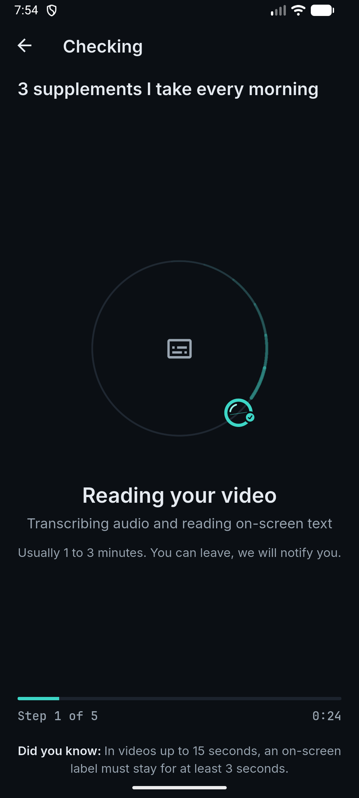
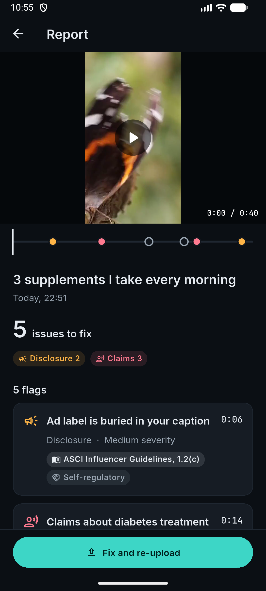
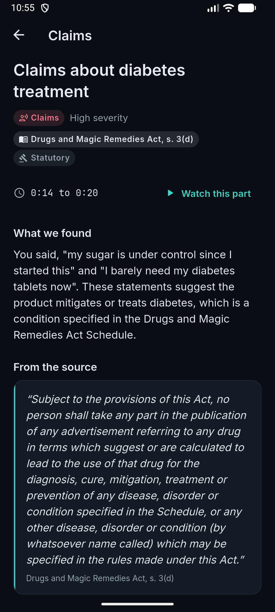
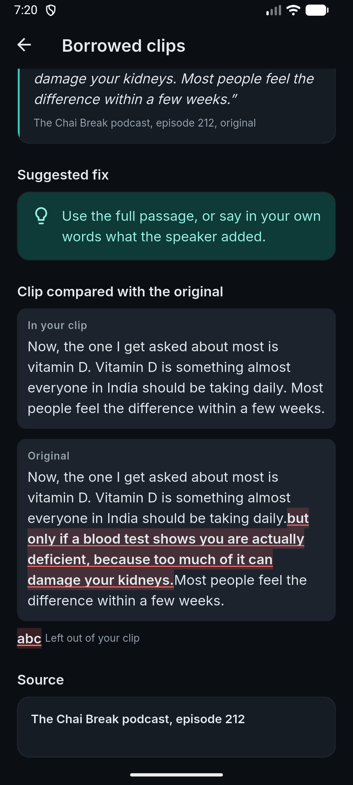
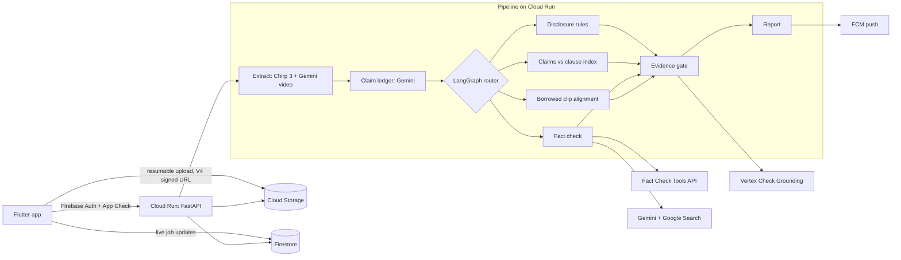

# ContextLens

**Check a creator video before it goes live.** ContextLens is an Android app (Flutter) that reads a reel the way a regulator would: it finds the brand deal without a label, the supplement that "cures" diabetes, the podcast clip that leaves out the doctor's warning and the statistic a fact-checker has already debunked, then cites the exact rule or source for each one and suggests a fix.

Built by team **Tekken** for the Google Cloud AI Builder Cup 2026.

## The problem

Indian creators and the agencies and brands behind them publish under rules most of them have never read:

- **ASCI's Guidelines for Influencer Advertising in Digital Media.** Any material connection (paid, gifted, discounted, affiliate) needs a label such as Ad or Collaboration, up front, not buried in hashtags, and on screen for long enough (3 seconds for reels up to 15 s, a third of the video up to 2 minutes). Health and finance creators must also state their qualifications. ASCI found that 98% of the 1,173 influencer ads it investigated from April to September 2025 needed changes.
- **The Drugs and Magic Remedies (Objectionable Advertisements) Act, 1954.** It is law, not self-regulation: no ad may suggest a product treats or prevents a condition in its Schedule, which includes diabetes, high or low blood pressure, obesity and cancer.
- **Misleading borrowed clips.** A 12 second cut of a doctor saying "everyone should take vitamin D daily" can drop the "but only if a blood test shows you are deficient" that came right after.

Lawyers and agency review do not scale to every reel. ContextLens is the pre-publish check a creator can run in about a minute.

## Demo

- Demo video: _link to be added_
- **Web app:** https://contextlens-tekken.web.app (pick a video, resumable upload, live progress, report; no share sheet or push on the web)
- **Android APK:** https://contextlens-tekken.web.app/download/contextlens.apk (release build, obfuscated; allow installs from your browser, Android 7 or later; SHA-256 `aa9aa012fd70a0226fcc493179a54da1d7a43ce52a0998e2797a4b8ebf740d52`)

| Checking | Report | Flag detail | Borrowed clip |
|---|---|---|---|
|  |  |  |  |

## How it works

1. **The creator picks a video** (or shares one from another app) and fills a short declaration: the exact caption, whether it is paid and for which brand, any borrowed clips (a link or the original file) and the topic.
2. **The app uploads it** straight to Cloud Storage with a resumable upload (pause, resume, survives flaky networks), then the backend starts the check.
3. **The check runs in five stages**, shown live: reading the video, finding claims, checking claims, weighing the evidence, writing the report. A push notification says when it is ready.
4. **The report** puts every flag on the video's timeline with what was found, the rule or source, a verbatim quote from it, and a suggested fix. Fix and re-upload compares the new run with the old one ("3 of 4 issues resolved").

The heart of it is the **claim ledger**: everything checkable in the video, typed and timestamped. Speech comes from Chirp 3 with word timestamps; overlays, labels, products and before and after shots come from Gemini watching the video. Gemini then picks and types ledger items (brand mention, material connection, offer, health claim, financial claim, factual claim, quote of others) by pointing at numbered sentences and overlays. The words and times are always copied from the transcript or overlay, never written by the model, so a ledger item cannot contain something that was not said or shown.

## Architecture



| Google Cloud service | What it does here |
|---|---|
| Cloud Run | The API and the check pipeline (FastAPI, Python 3.13) |
| Cloud Storage | Uploaded videos and clip originals, V4 signed URLs, deleted after a day |
| Firestore | Job documents the app listens to live; owner-only rules, TTL on `expiresAt` |
| Firebase Auth | Anonymous accounts; every API call carries a Firebase ID token |
| Firebase App Check | Play Integrity (debug provider in debug builds), enforced by the API |
| Firebase Cloud Messaging | "Your report is ready" notifications |
| Speech-to-Text, Chirp 3 | Word-level timestamps, language auto-detect (English, Hindi, Hinglish) |
| Gemini on Vertex AI | Video reading, claim ledger, claims judgement, fact-check verdicts (`gemini-2.5-flash`, `us-central1`) |
| Vertex AI embeddings | Retrieval over the clause index (`text-embedding-005`) |
| Check Grounding (Vertex AI Search) | Second signal in the evidence gate |
| Fact Check Tools API | Looks for an existing published fact check first |
| Secret Manager | The Fact Check Tools key |
| Cloud Build, Artifact Registry | Builds and stores the backend image |

## Checkers and the evidence gate

| Checker | How it decides | What it cites |
|---|---|---|
| Disclosure | Deterministic rules on the ledger: a material connection or offer needs a permitted label up front in the caption and on screen for 3 s (up to 15 s), a third of the video (up to 2 min) or the whole promoted part | ASCI Influencer Guidelines 1, 1.2(b), 1.2(c), 1.2(d)(I to III) |
| Claims | Each claim is judged by Gemini against the clauses retrieved for it, and may only cite those. Conditions in the Act's Schedule bring s. 3(d) in front of the judge | ASCI Code Chapter I, Influencer Guidelines Addendum II, Drugs and Magic Remedies Act s. 3(d) and 4 |
| Fact check | Fact Check Tools first; otherwise Gemini with Google Search, preferring Indian government, health bodies and IFCN fact-checkers | The page Gemini retrieved, with a quote from it |
| Borrowed clips | The original (attached file, transcribed with Chirp, or a YouTube link) is aligned with the creator's words: rapidfuzz windows, then difflib word alignment. Flags splices, cuts mid-sentence, words dropped at the start and an omitted qualifier that follows | The original, with a word-level diff |

Every compliance citation names its clause and says whether it is **statutory** (the Act) or **self-regulatory** (ASCI). The clause text lives in `backend/app/clauses/index.json`, copied word for word from the ASCI Code Book and the Act.

**The evidence gate abstains rather than guesses.** Before a flag reaches the report, every quoted span must appear word for word in what it cites: the clause text, the video's transcript, overlays or caption, a page we fetched, a Fact Check Tools response, the clip's original, or a span Google Search grounding ties to a page Gemini retrieved. Interpreted flags then go through Vertex Check Grounding: for claims, the premises (what the creator said and what the clause says), because the service scores an inference like "which suggests a cure" near zero even when it is sound; for fact checks, what the sources say against the fetched pages. A flag that fails either test is shown as **"Uncertain, needs a human look"** and is never counted as an issue.

## Real example

`supplements_hinglish.mp4`: a 40 s synthetic reel in Indian English with one Hindi line, a discount code on screen and a `#ad` that appears only in the last 1.5 s.

| Time | Flag | Rule or source | Gate |
|---|---|---|---|
| 0:06 | Ad label is buried in your caption (`#ad` is hashtag 4 of 4) | ASCI Influencer Guidelines 1.2(c), self-regulatory | Verified |
| 0:14 | Claims to treat diabetes ("I barely need my diabetes tablets now") | Drugs and Magic Remedies Act s. 3(d), statutory | Verified, grounding 0.98 |
| 0:22 | Vitamin C does not prevent colds (fact check, contradicted) | Pages retrieved by Search (Cochrane, NIH) | Verified in 8 of 13 runs; otherwise uncertain or skipped |
| 0:30 | Exaggerated energy claim ("Ek mahine mein mera energy level double ho gaya") | ASCI Code Chapter I, 1.5 | Verified, grounding 0.97 |
| 0:38 | On-screen Ad label is too short and too late (1.5 s, needs 13.5 s) | ASCI Influencer Guidelines 1.2(d)(II) | Verified |

## Benchmark

34 synthetic cases sent through the deployed pipeline; full method and caveats in [benchmark/RESULTS.md](benchmark/RESULTS.md). The reels are recreations of ASCI case types, not real creator videos, and the set is small.

| Metric | Result |
|---|---|
| Disclosure precision / recall | 1.00 / 1.00 |
| Claims precision / recall | 1.00 / 1.00 (up from 0.43 after merging and stricter gating) |
| Clause citation accuracy | 0.93 |
| Borrowed clips precision / recall | 1.00 / 1.00; alignment within 2 s: 4 of 4 |
| Fact-check agreement with Indian fact-checkers | 8 of 8 (7 via the Fact Check Tools lookup) |
| Fresh claims with no published fact check | 2 of 4 agree, 2 abstain, 0 wrong |
| Abstention (flags marked uncertain) | 26% |
| Evidence-gate failures on recheck | 0 of 55 |

## Latency and cost

- Median 36 s from submit to report on the benchmark reels (p90 65 s); the 40 s supplements reel takes 39 to 87 s.
- Median by stage: extract 6.3 s, claim ledger 8.3 s, checking 14.8 s, evidence gate 0.3 s.
- About USD 0.05 per reel at list prices (about 5,100 input and 3,100 output Gemini tokens, one search-grounded call, Chirp audio). Check Grounding is not included.
- The slow tail is Vertex returning 429 or 504 under shared capacity. Model calls are hedged (a second request after 35% of the deadline), retried with backoff, and fall back to the global endpoint; a checker that still fails is skipped and the report says so.

## Security and privacy

- Every API call needs a Firebase ID token; App Check is enforced on the API.
- Videos go to Cloud Storage through V4 signed URLs signed by the service account through IAM (no keys anywhere); clients have no direct storage access.
- Firestore rules: a user can read only their own jobs; nothing can be written from the app.
- Secrets live in Secret Manager. No keys in the app or the repo (the Firebase client config is public by design). The API never logs URLs with query strings, tokens, captions or file paths.
- Videos, transcripts and reports are deleted after 24 hours (GCS lifecycle and Firestore TTL). **Delete my data** in Settings deletes every job and video, unregisters push and signs out.

## Repo structure and how to run

```
lib/            Flutter app (features: compose, upload, run, report, push, settings)
backend/app/    FastAPI API and the check pipeline (pipeline/, pipeline/checks/, clauses/)
backend/tests/  Unit tests (disclosure rules, evidence gate, alignment) and the API smoke test
benchmark/      Cases, generator, runner and RESULTS.md
docs/           Build spec, infrastructure record (INFRA.md), screenshots
```

- **App, mock mode** (no backend, bundled fixtures): `flutter run --dart-define=MOCK_SEED=1`
- **App, real mode**: `flutter run --dart-define=BACKEND=real --dart-define=API_BASE_URL=<Cloud Run URL> --dart-define=APP_CHECK_DEBUG_TOKEN=<registered debug token>`
- **Tests**: `flutter test` and, in `backend/`, `.venv/Scripts/python.exe -m pytest tests`
- **Backend locally**: `backend/tools/run_pipeline.py VIDEO --caption ...` runs the real pipeline on a local file with your gcloud credentials.
- **Deploy**: Cloud Build then `gcloud run deploy`; every resource, role and setting is recorded in [docs/INFRA.md](docs/INFRA.md). No secrets are needed in the repo.

## Limitations and roadmap

- **No link fetching from the video by design**: we check what is said and shown, plus sources the creator declares.
- **English and Hindi** (including Hinglish) only so far.
- **Synthetic benchmark**: real reels with music, cuts and noise are next.
- **Fact checks depend on search results**: verdicts on claims no fact-checker has covered can vary between runs; when the evidence cannot be verified the flag stays uncertain.
- **Claims over-flagging**: merging duplicate findings and a stricter judge are next.
- **In progress**: Google sign-in linking, a resume banner for uploads interrupted by an app restart, borrowed clips from links other than YouTube, iOS.

## Team Tekken

| Member |
|---|
| Arvinth |
| Anju Priya Manam |
| Akash |

Built for the Google Cloud AI Builder Cup 2026.
